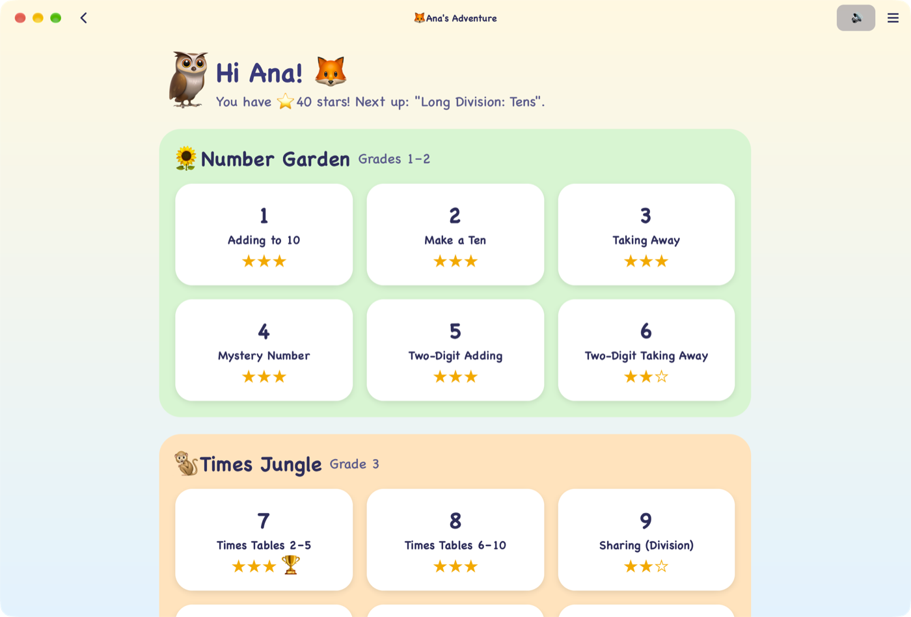
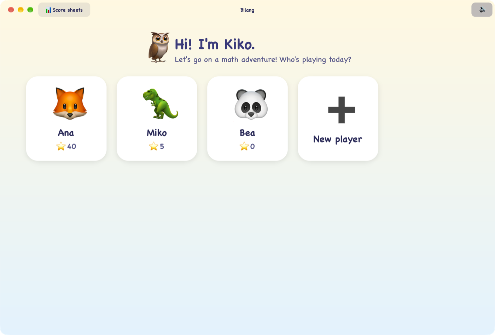
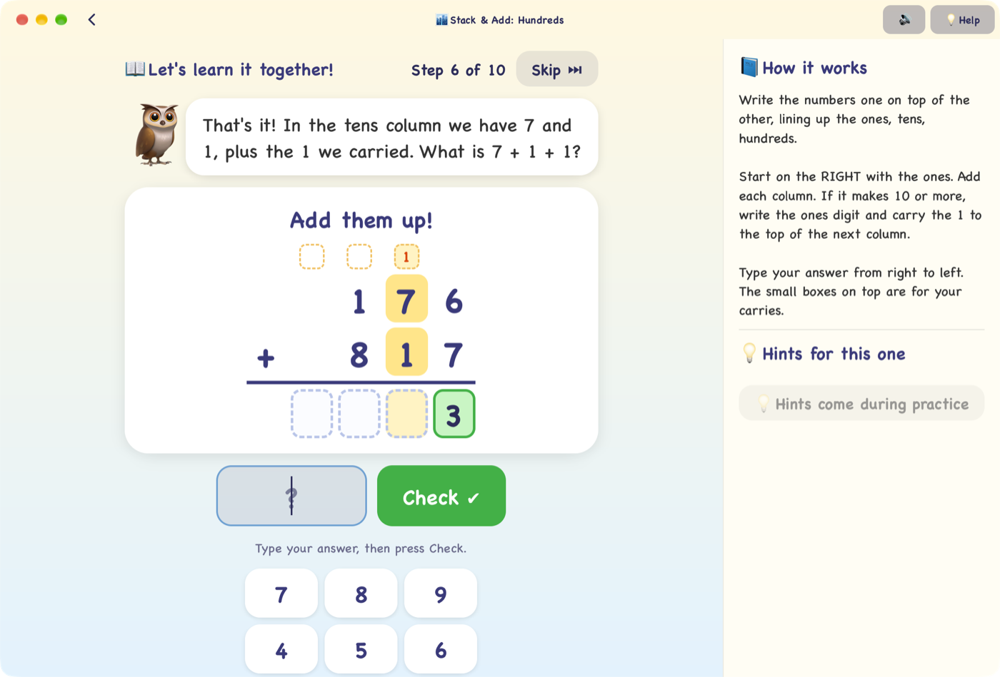
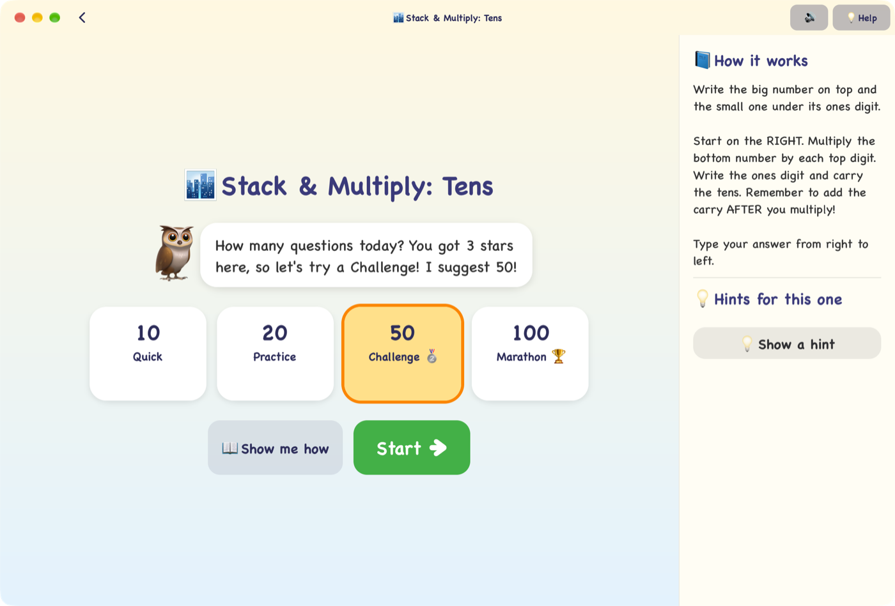
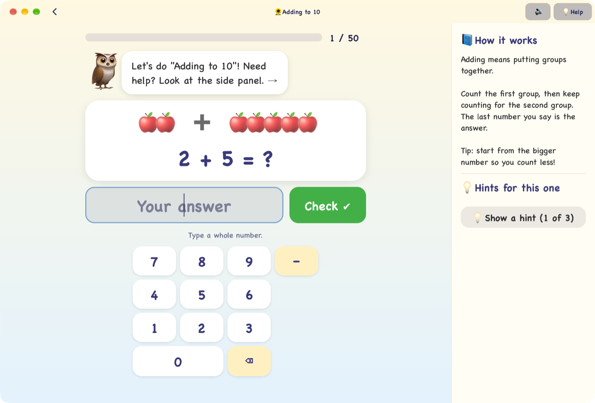
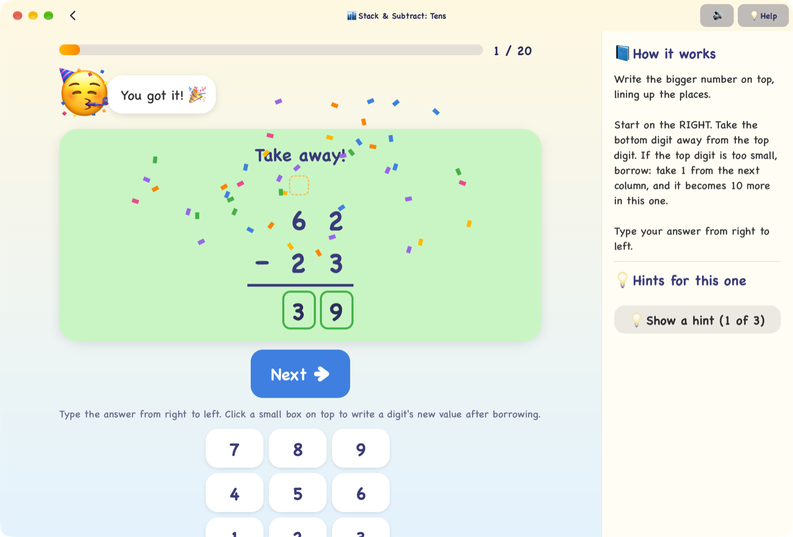
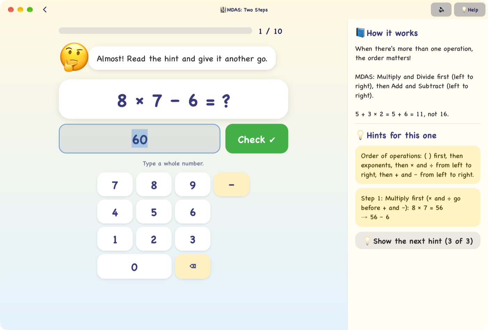
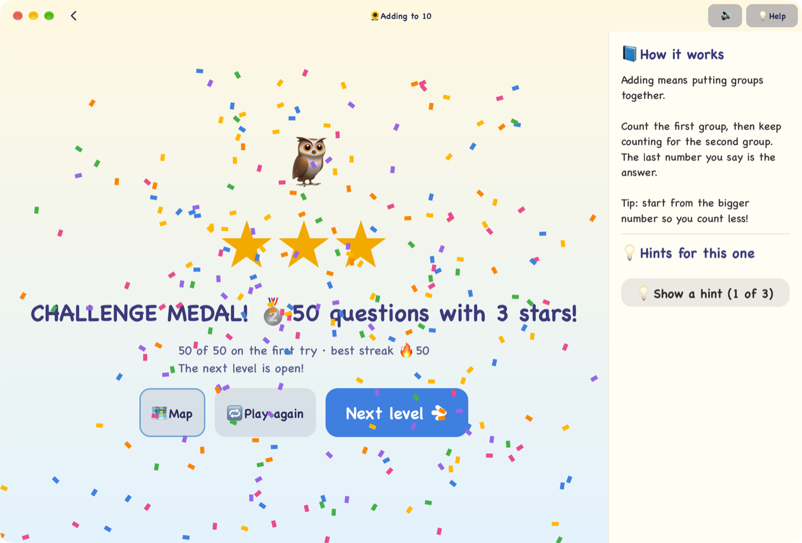
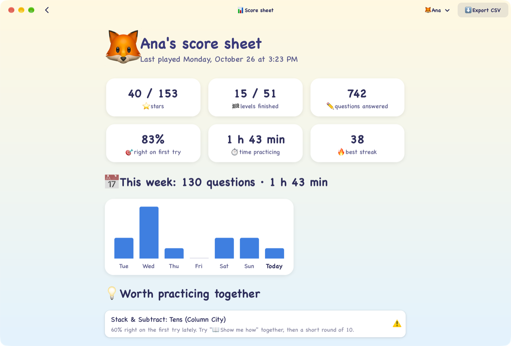

# 🦉 Bilang: a math adventure for kids

[](https://github.com/tofilagman/bilang/actions/workflows/ci.yml)

**Bilang** (Filipino for *count*) is a free desktop game that teaches children math,
from counting apples all the way to solving quadratics. **Kiko the owl** guides each
child through it. Kiko cheers them on, teaches every new skill step by step the way a
parent or teacher would, and never leaves anyone stuck.

It works offline, with no accounts, no ads and no internet needed.

<p align="center">
  
</p>

---

## Why Bilang?

- **It teaches, not just tests.** Every level starts with a hands-on lesson. Kiko
  works one example *with* the child, asking small questions and showing exactly what
  to write and where.
- **Mistakes are part of learning.** A wrong answer opens the next hint, and the hints
  go from a gentle nudge to the full worked solution using that problem's own numbers.
  After every hint, Kiko simply tells the answer, so nobody gets stuck or discouraged.
- **It's fun.** There are stars, streaks 🔥, confetti 🎉, cheerful sounds, animal
  buddies, medals for long runs, and a map to explore.
- **It's taught the way school teaches it.** Adding, subtracting, multiplying and long
  division are done **stacked on paper**, column by column, with carrying and borrowing.
- **Parents can see how it's going.** A score sheet shows progress, practice time, what
  needs more work, and every question the child needed help with.

---

## A tour

### 👋 Who's playing?

Each child picks an animal buddy and gets their own stars and progress. There are no
passwords.



### 📖 Kiko teaches it first

The first time a child opens a level, Kiko walks through one example together. In
stacked problems, the column being talked about lights up, and only the right box
takes the digit:

> *"18 is 1 ten and 8 ones. Write the 8 under the ones… The 1 ten moves next door!
> Write a little 1 on top of the tens column. That's called carrying."*



### 🔢 How many questions today?

Children choose a **Quick 10**, **Practice 20**, **Challenge 50** or **Marathon 100**
round. Kiko suggests one based on how they did before. "📖 Show me how" replays the
lesson any time.



### 🍎 Start with counting…

Young players get pictures to count, an on-screen keypad, and a side panel that
explains the idea in kid-friendly words.



### 🏙️ …work stacked problems like on paper…

Children fill in the answer box by box, from the ones place, with little boxes for
carries. Checking turns each digit green or red, so they see exactly which column to
fix.



### 💡 …and get help when they need it

A wrong answer reveals the next hint. Order-of-operations problems are solved one step
at a time on the board ("Multiply first (× and ÷ go before + and −)").



### 🏆 Stars, streaks and medals



### 📊 The score sheet, for parents and teachers

Open **📊 Score sheets** on the first screen to see each child's:

- totals: stars, levels finished, questions, % right on the first try, practice time
- practice this week, day by day
- levels **worth practicing together**, flagged when recent sessions dip below 70%
- every session, including the exact questions they needed help with and what they
  typed first

**Export CSV** saves everything as a spreadsheet you can share with a teacher.



---

## What's inside

Seven worlds and 51 levels, from Grade 1 up to high school:

| World | Grades | What children learn |
|---|---|---|
| 🌻 Number Garden | 1–2 | adding to 10, make a ten, taking away, mystery numbers, 2-digit + and − |
| 🐒 Times Jungle | 3 | times tables, division facts, bigger multiplying, remainders |
| 🏙️ Column City | 2–4 | stacked +, −, × and long division with tens, hundreds and thousands |
| 🏰 MDAS Castle | 4–5 | order of operations (MDAS), parentheses, story problems, area & perimeter |
| 🌊 Fraction Falls | 5–6 | simplifying, + − × ÷ fractions, decimals, percent |
| 🌋 Integer Volcano | 6–7 | negative numbers, exponents & square roots, PEMDAS |
| 🏔️ Algebra Peak | 7–10 | equations, substitution, proportions, sales & percents, Pythagoras, slope, systems, quadratics |

- Every question is freshly generated, so there are always new ones to practice.
- Finishing a level unlocks the next. Older children can skip ahead: a grown-up can
  turn on **Unlock all levels** in the ☰ menu on the map.
- **"Almost!" answers** (6/8 instead of 3/4, x and y swapped, a forgotten remainder)
  get a friendly nudge instead of counting as wrong.
- Stars: ⭐⭐⭐ for 90% or more right on the first try, ⭐⭐ for 60% or more, ⭐ for finishing.
- Medals: 🥈 for 50 questions with 3 stars, 🏆 for 100.

---

## Download

Get the latest version from the **[Releases page](https://github.com/tofilagman/bilang/releases/latest)**:

| Computer | Download |
|---|---|
| **Windows** (64-bit) | `Bilang-…-windows-x64-setup.exe`, or the portable `.zip` |
| **Mac** (Apple silicon: M1 or newer) | `Bilang-…-mac-arm64.dmg` |
| **Ubuntu 24.04+ / Debian 13+** | `Bilang-…-linux-amd64.deb` |
| **Any Linux** | `Bilang-…-linux-x86_64.flatpak` |

Bilang isn't signed by Apple or Microsoft yet, so the first time you open it your
computer asks to make sure:

- **Windows:** if you see "Windows protected your PC", click **More info → Run anyway**.
- **Mac:** drag Bilang into Applications, then **right-click Bilang → Open → Open**.
- **Ubuntu:** `sudo apt install ./Bilang-*-linux-amd64.deb`
- **Flatpak:** `flatpak install --user Bilang-*.flatpak`

## Building from source

Bilang is built with Rust and GTK 4 / libadwaita.

**1. Install Rust:** see <https://rustup.rs>.

**2. Install GTK 4 and libadwaita (1.5 or newer):**

```bash
# macOS (Homebrew)
brew install gtk4 libadwaita adwaita-icon-theme
```

```bash
# Fedora
sudo dnf install gtk4-devel libadwaita-devel alsa-lib-devel
```

```bash
# Ubuntu 24.04+ / Debian 13+
sudo apt install build-essential libgtk-4-dev libadwaita-1-dev libasound2-dev
```

On Windows, install [MSYS2](https://www.msys2.org/), open the **UCRT64** terminal, and run:

```bash
pacman -S mingw-w64-ucrt-x86_64-gtk4 mingw-w64-ucrt-x86_64-libadwaita mingw-w64-ucrt-x86_64-rust mingw-w64-ucrt-x86_64-pkgconf mingw-w64-ucrt-x86_64-gcc git
```

Then do step 3 in that same terminal (you can skip installing Rust in step 1).

**3. Build and play:**

```bash
git clone https://github.com/tofilagman/bilang.git
cd bilang
cargo run --release
```

> Every change is built and tested automatically on Linux, macOS and Windows (see the
> CI badge above). So far the game itself has been played on macOS, so reports from
> Linux and Windows players are very welcome!

### Where progress is saved

Everything stays on your computer:

- macOS: `~/Library/Application Support/io.r3al.Bilang/`
- Linux: `~/.local/share/bilang/`
- Windows: `%APPDATA%\r3al\Bilang\data\`

`players.json` holds the children and their stars. `history/<id>.json` holds each
child's sessions for the score sheet (the last 1,000 are kept). Bilang never sends
anything over the internet.

---

## For developers

```
src/
  levels.rs   the worlds, levels and problem generators (with hints)
  answer.rs   reading and checking answers, "almost" feedback
  expr.rs     order-of-operations solver that explains each step
  teach.rs    the "Show me how" lesson scripts
  learn.rs    the lesson screen
  column.rs   the stacked ("two-layer") answer pad
  play.rs     a level: question picker, play, results
  history.rs  session recording, stats, CSV export
  scores.rs   the parents' score sheet
  main.rs     players, map, styles
packaging/    app icon, Mac/Windows/Linux installers
```

- CI (`.github/workflows/ci.yml`) builds and runs the tests on Ubuntu 24.04, macOS
  (Homebrew) and Windows (MSYS2 UCRT64) for every push and pull request.
- Releases (`.github/workflows/release.yml`): push a tag matching the Cargo.toml
  version (`git tag v0.1.0 && git push origin v0.1.0`) and CI builds the installers
  from `packaging/` and publishes them. Running the workflow by hand builds them
  as artifacts without publishing. The packaging scripts:
  - `packaging/macos/bundle.sh` makes a self-contained `.app` and `.dmg`.
  - `packaging/windows/package.sh` (in the MSYS2 UCRT64 shell) makes the installer and zip.
  - `cargo deb` makes the `.deb`.
  - `packaging/linux/io.r3al.bilang.yml` is the Flatpak manifest.
- `cargo test` checks:
  - every level's generator, 300 times each
  - every stacked lesson, to make sure it writes exactly the right answer
  - the history and stats code
- `cargo test samples -- --ignored --nocapture` prints a problem with its hints from
  every level, for proofreading. `cargo test lesson_samples -- --ignored --nocapture`
  does the same for lessons.
- Test hooks:
  - `BILANG_DATA=<dir>` uses another data folder.
  - `BILANG_START=<player>[:<level>]` opens a player's map or a level.
  - `BILANG_SHEET=<player>` opens a score sheet.
  - `BILANG_DEBUG=1` logs each answer and lesson step.

Ideas, new levels, translations and bug reports are all welcome. Open an issue or a
pull request. 🦉

---

## License

Bilang is free and open source under the [MIT License](LICENSE). Use it at home or in
class, share it, and build on it.
